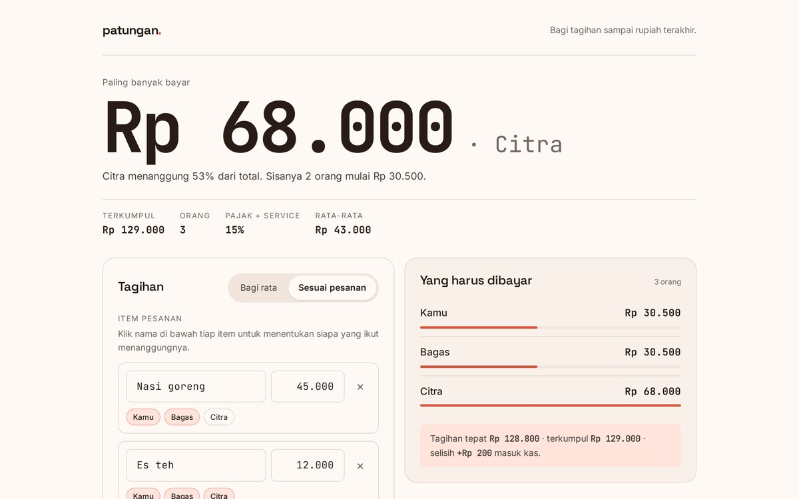

<div align="center">

# Patungan

**Bagi tagihan makan sesuai pesanan — pajak proporsional, pembulatan tanpa selisih.**

[](https://atmajadesna.github.io/patungan/)


<a href="https://atmajadesna.github.io/patungan/"></a>

</div>

## Masalahnya

Bagi tagihan rata per orang itu gampang, tapi tidak adil kalau yang pesan nasi goreng Rp45.000 ikut menanggung pajak sama besar dengan yang cuma pesan es teh.

## Yang menarik di dalamnya

**Pajak proporsional** — Tiap orang menanggung pajak dan service sebesar porsi pesanannya, bukan dibagi rata.
**Largest remainder** — Sisa pembulatan dibagi ke yang sisa desimalnya terbesar, sehingga jumlah semua bagian persis sama dengan total tagihan — nol selisih.
**Pembulatan bisa diatur** — Kelipatan Rp1, Rp100, Rp500, atau Rp1.000 sesuai kebiasaan transfer.

## Jalanin

Buka `index.html` di browser.

```bash
python3 -m http.server 8000
```

Tidak ada dependency, tidak ada build step. Semua jalan di browser.

## Struktur

```
index.html    tampilan dan struktur halaman
app.js        seluruh logika: data, hitungan, penyimpanan
styles.css    tata letak dan komponen
tokens.css    warna, ukuran teks, dan spasi sebagai variabel
```

## Catatan

Contoh: tagihan Rp128.800 → terkumpul Rp129.000 → 30.500 / 30.500 / 68.000, pas tanpa selisih.

Dibuat dengan JavaScript, HTML, CSS, tanpa framework.
